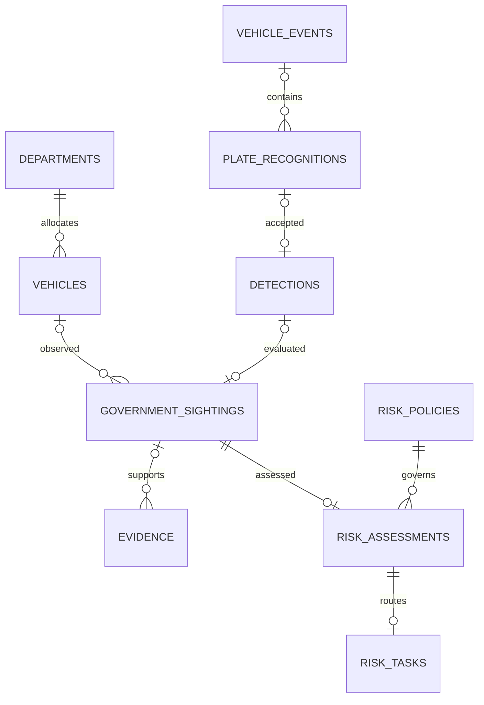

# PostgreSQL migration and risk assessment

Implemented on 6 October 2026. The Docker application now stores operational records in PostgreSQL. CSV/JSON files are retained as legacy import sources; images remain in the existing mounted `data/snapshots/` directory.

## Docker startup

```powershell
docker compose up -d --build
docker compose ps
docker compose logs --tail=60 backend
```

The `db` service runs PostgreSQL 16 with a named `postgres-data` volume. The backend waits for the database health check, runs `alembic upgrade head`, imports legacy records, seeds missing demo users, initializes the risk policy, then starts FastAPI. `/health` checks database connectivity. Containers use `db:5432`; pgAdmin on the host uses `127.0.0.1:5433` by default (configurable with `POSTGRES_PORT`).

`POSTGRES_PASSWORD` can be configured in `.env`; without it, Compose uses `just-meter-local-demo`. The Compose URL expects a URL-safe password. Demo user password overrides apply on the first seed only. Existing hashed passwords survive restarts. SMTP/WhatsApp connection settings continue to use environment configuration.

## Schema and relationships

| Tables | Responsibility |
|---|---|
| `departments`, `vehicles` | Unique normalized plates, department foreign keys, officer contact details, authorization areas/schedules, active registry state |
| `users` | Persistent demo accounts, bcrypt hashes, roles and active state |
| `vehicle_events`, `plate_recognitions` | Capture metadata and recognition-to-frame relationships |
| `detections`, `government_sightings` | Plate sightings, vehicle relationships, compliance decision snapshots, unique violation IDs |
| `evidence` | Event/recognition/violation relationships, review/case states, image references and hashes |
| `geofences` | Configurable zone records and polygon definitions |
| `risk_policies`, `risk_assessments` | Immutable policy versions and the original assessment inputs/contributions/results |
| `risk_tasks` | Assigned officer role, priority, recommended action and acknowledgment |
| `audit_events` | Risk policy changes, assessments and task acknowledgments |
| `legacy_imports`, `alembic_version` | Import counts/checksums and schema revision |



Typed keys, timestamps, indexes and constraints support relationships and risk-history queries. JSON payloads preserve capture-time API snapshots and nested rule/score explanations. Older source records without matching parent IDs retain their metadata with nullable relational links; the importer does not invent missing events. Removing a registry entry deactivates it so historical vehicle references remain valid. Correcting a plate preserves the vehicle's database identity.

The initial migration covers existing persistence. Migration `0002_vims` adds offline source synchronization, temporal assignments, duty-slip records and synchronization history; see [VIMS synchronization](modules/09-05-vims-synchronization.md). Migration `0003_duty_verification` adds source coverage and archived officer duty reviews; [duty verification](modules/09-09-duty-slip-verification.md) now runs at capture time. A final duty review preserves the original compliance/risk snapshot and updates the effective assessment and linked evidence transactionally. The formal challan lifecycle remains outstanding. Officer contact/risk sensitivity fields remain registry attributes. Evidence metadata remains mutable; database persistence does not establish immutable evidence history.

## Legacy import

The startup importer reads these files from `data/` in dependency order:

1. `approved_government_vehicles.csv`
2. `vehicle_detection_events.csv`
3. `plate_recognition_events.csv`
4. `detections.csv`
5. `government_vehicles_spotted.csv`
6. `evidence_records.csv`
7. `geofences.json`

Original files and images are not rewritten. Existing event/recognition/evidence/violation IDs and image paths are retained. Stable import keys identify historical rows without IDs. Sources are imported in one transaction; malformed identifiers/timestamps or database failures roll back the batch. A ledger records each source checksum and row count. Repeating startup skips imported sources, including changed legacy files, so stale CSV data cannot overwrite database edits. Further changes belong in the application/database; investigate a changed-source report before designing an additional import.

Inspect results without displaying vehicle/person details:

```powershell
docker compose exec -T backend python -m backend.database_report
docker compose exec -T backend python -m backend.migrate_legacy --dry-run
docker compose exec -T backend alembic current
docker compose exec db psql -U just_meter -d just_meter
```

Useful SQL for a demonstration:

```sql
\dt
SELECT source, row_count, imported_at FROM legacy_imports;
SELECT v.plate_number, s.violation_id, r.score, r.level, p.version
FROM risk_assessments r
JOIN risk_policies p ON p.id = r.policy_id
JOIN government_sightings s ON s.id = r.sighting_id
LEFT JOIN vehicles v ON v.id = s.vehicle_id
ORDER BY r.id DESC LIMIT 10;
```

Historical risk values remain in their original sighting snapshots. Import does not retrospectively score records or create review tasks under a new policy. New accepted sightings create versioned assessments and qualifying review tasks.

## Module 9.10 behavior

The risk engine receives a compliance result after accepted ANPR processing. It scores confirmed violations using the saved policy, with a default 30-day window ending at capture time. Future events and events outside that window do not affect the score. Historical High/Critical cases add a separately capped severity-history contribution.

Registry risk context is configurable as Standard, Sensitive or Critical in Authorized Vehicles. Missing context is displayed explicitly and adds no points. This is officer-maintained registry context, not a verified VIMS assignment. Existing history follows the stable vehicle ID when a plate is corrected.

Overlapping unauthorized-area, geofence and destination criteria contribute their maximum route weight once. Repeat contributions, severe-history contributions and the final score are capped. Confirmed type/appearance mismatch inputs have a High minimum; plate mismatch has a Critical minimum. Those integrity inputs still depend on future verification/compliance integration. Unknown violation criteria produce a policy-review task instead of a guessed score.

| Level | Default score | Notification priority | Assigned role |
|---|---|---|---|
| Low | 0-24 | Normal | Transport Officer |
| Medium | 25-49 | Elevated | Transport Officer |
| High | 50-74 | High | Supervisory Officer |
| Critical | 75-100 | Urgent | Supervisory Officer |

The default score threshold for recommending challan review is 50. Lower scores recommend warning review. These recommendations enter a persistent internal task queue in the Violations page. They do not send external messages or issue challans. Acknowledgment records receipt by the assigned role or Administrator; it is not an approval decision. The existing count-based challan workflow remains separate and still needs the formal 9.15 review/approval lifecycle.

Administrators edit weights, thresholds and history settings in the risk panel. Each update creates a policy version, checks the expected current version to prevent overwriting another edit, and writes an audit record. Existing assessment scores retain their original version and explanation. Auditors can read; only the assigned officer role or Administrator can acknowledge a task.

| Endpoint | Purpose |
|---|---|
| `GET /api/risk/policy` | Current version/configuration |
| `PUT /api/risk/policy` | Administrator creates a policy version with `expected_version` and `config` |
| `GET /api/risk/tasks?status=OPEN` | Review queue ordered by score; also supports `ACKNOWLEDGED` and `ALL` |
| `PATCH /api/risk/tasks/{id}/acknowledge` | Assigned role or Administrator records receipt |

Detection, compliance snapshot, risk assessment and review task are committed together. A PostgreSQL advisory transaction lock serializes pilot writes so concurrent processes cannot independently increment recurrence for the same event. Recognition uniqueness and database-backed camera/plate cooldown survive application restarts. Image files remain outside SQL transactions; backups must include both the database and snapshots.

## Executive dashboard

The default **Overview** tab reads these PostgreSQL tables through `GET /api/dashboard`, with date and capture-time department filters. It shows department activity, risk distributions, daily trends and the existing officer tasks. Acknowledgment uses the same role checks and audit trail as the Violations page. No additional migration is required. See [module 9.13](modules/09-13-executive-dashboard.md) for definitions and limitations.

## Container tests

```powershell
docker compose run --rm --no-deps backend python -m backend.test_runner --postgres
docker compose run --rm --no-deps frontend npm run build
```

Validation on 6 October 2026: **49 backend tests passed against PostgreSQL**, the frontend TypeScript/Vite build passed, all seven legacy sources imported with matching counts, and backend restart retained those counts without duplicate imports. Live authenticated API/evidence-image checks and dashboard HTTP succeeded.

The backend runner creates a uniquely named PostgreSQL schema, applies migrations, uses temporary image directories, runs the suite, and removes only that test schema. It never truncates application tables. SQLite is also supported by this runner for quick isolated checks; Docker runtime uses PostgreSQL. Use the runner rather than raw unittest discovery against the live application database.

## Backup and shutdown

```powershell
docker compose exec -T db pg_dump -U just_meter -d just_meter --file=/tmp/just_meter.sql
docker compose cp db:/tmp/just_meter.sql ./just_meter-backup.sql
docker compose down
```

Preserve `data/snapshots/` alongside the SQL backup. Normal `docker compose down` retains named volumes. `docker compose down -v` removes volumes, including PostgreSQL data. Original CSV files only cover the pre-migration records and cannot recover subsequent database activity.
