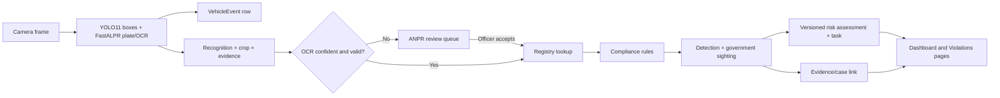

# Just Meter / GovTrack FYP implementation study guide

> **Historical study notes:** The percentages and module descriptions below reflect an earlier milestone. For the current completion estimate and gaps, use the [scope assessment](modules/implementation-status.md).

**Current code review: 8 October 2026.** Read this with [the current status scorecard](modules/implementation-status.md) and the [complete API catalogue](fyp-api-catalogue.md). This guide describes the running code, including local, uncommitted files. The scope PDF supplies requirements, not executable instructions. Its names “GovTrack AJK” and “Just Meter AJK” refer to this project.

## First, state the scope honestly

The scope has 18 modules. On the current equal-group estimate, **48.5/90 = 53.9%** of scoped functionality is implemented. Eight modules are substantial, seven have partial implementation or foundations and three are not started; none meets the entire scope. This is a review estimate, not model accuracy. The offline VIMS foundation supplies registry, driver, assignment and duty-slip records; duty verification uses them at capture time with coverage checks and audited officer resolution. The Digital Twin now brings these records together with sightings, compliance, risk/tasks and evidence under a stable vehicle identity. Live institutional integration and automatic destination/context matching remain outstanding.

| Term | Meaning in this code |
|---|---|
| Vehicle detection | A YOLO box, class and confidence for one frame. A vehicle appearing in ten frames can contribute ten detections. |
| Frame event | A saved camera frame's metadata, including a count of vehicle boxes. |
| Plate recognition | A FastALPR plate box and OCR reading, possibly awaiting human review. |
| Detection record | An accepted, nonduplicate plate capture with a saved snapshot. |
| Government sighting | A detection whose plate matched the active local government registry, with a compliance decision. |
| Violation | A government sighting with `status=VIOLATION`. Unknown plates are not government violations. |
| Risk assessment | A versioned rules-based score for a government sighting. It is **not** an ML prediction or probability. |
| Risk task | An internal officer review item. `ACKNOWLEDGED` means receipt, not approval or case resolution. |
| Challan eligibility / issuance | Four confirmed observations establish eligibility and create a draft. An independent approval and explicit issuance action are required for a persisted issued case and archived PDF. |

## Technology and models you should know

| Layer | Current implementation | Where to point |
|---|---|---|
| Frontend | React 18, TypeScript, Vite, Tailwind via CDN, Lucide icons. Navigation defaults to Overview. | [App](../frontend/src/App.tsx), [Navbar](../frontend/src/components/Navbar.tsx), [API client](../frontend/src/api/client.ts) |
| API | Python 3.11, FastAPI, Pydantic request/response models, OpenCV frame/video handling, WebSocket live feed. | [Routes](../backend/main.py), [schemas](../backend/models.py) |
| Vehicle model | Ultralytics **YOLO11 nano**, local weights `yolo11n.pt`. COCO class IDs 2 car, 3 motorcycle, 5 bus, 7 truck. Default vehicle confidence 0.45. Boxes are frame-local; there are no track IDs. | [DetectorService.detect](../backend/detectors.py), [settings](../backend/config.py) |
| Plate detection | FastALPR's plate detector, initialized with detector confidence 0.4. Its underlying plate-detector model is not separately named/configured in this repository. | [DetectorService._models](../backend/detectors.py) |
| OCR | FastALPR **`cct-xs-v2-global-model`**. Character confidences are averaged if a list is returned. Default accepted OCR threshold 0.70, subject to valid plate text. No AJK-specific fine-tuning or published accuracy evaluation exists. | [DetectorService.detect](../backend/detectors.py), [analyze_plate_text](../backend/anpr.py) |
| Plate grammar | Normalized 1–4 letters followed by 1–4 digits; common OCR confusions produce suggestions. The generic grammar is a prototype rule, not an official plate standard. | [anpr.py](../backend/anpr.py) |
| Compliance | Deterministic area, recurring duty-hours and optional GPS polygon rules. | [compliance_engine.py](../backend/compliance_engine.py), [geofencing.py](../backend/geofencing.py) |
| Risk | Configurable weighted rule score, recurrence and context, with saved policy version and explanation. There is **no trained risk ML model**. | [risk_engine.py](../backend/risk_engine.py), [risk_store.py](../backend/risk_store.py) |
| Persistence | PostgreSQL 16 in Docker; SQLAlchemy ORM and Alembic migration `0001_database`. JSON payloads preserve capture-time details while typed columns/FKs link records. Images remain files under mounted `data/snapshots/`. | [models](../backend/db_models.py), [database](../backend/database.py), [migration](../migrations/versions/0001_database.py), [Docker guide](database-and-risk.md) |
| Identity | Four seeded users in PostgreSQL, bcrypt passwords, signed HS256 JWTs. | [auth.py](../backend/auth.py), [bootstrap.py](../backend/bootstrap.py) |
| PDF/notifications | ReportLab challan PDF; SMTP email, Meta WhatsApp Cloud API or optional WhatsApp Web bridge on an officer action. | [challan_pdf.py](../backend/challan_pdf.py), [mailer.py](../backend/mailer.py), [whatsapp_meta.py](../backend/whatsapp_meta.py), [whatsapp_bridge.py](../backend/whatsapp_bridge.py) |

The model names, thresholds and supported vehicle classes above are direct code facts. Training datasets, custom fine-tuning, quantitative ANPR accuracy, cross-camera tracking, make/model/color verification and predictive analytics are **not present**. Existing backend tests check application behavior, not AI precision/recall or deployment throughput.

## One accepted camera frame: data flow



1. The laptop calls `POST /api/camera/analyze`; the mobile scanner calls `POST /camera/frame`. Both execute [`receive_frame`](../backend/main.py). It validates image type/size and camera area, decodes with OpenCV, and calls [`DetectorService.detect`](../backend/detectors.py). The source field is `LIVE_FRAME`.
2. [`save_vehicle_event`](../backend/storage.py) writes one frame event with camera/time/source, dimensions, per-frame boxes and count. In video mode, [`analyze_recorded_video`](../backend/main.py) samples frames and saves these events only; it discards plate output at this stage.
3. Each OCR reading goes through [`analyze_plate_text`](../backend/anpr.py); [`save_plate_recognition`](../backend/storage.py) archives the plate crop. An uncertain plate gets `REVIEW_REQUIRED` and an evidence record, but does not become a violation. [`review_plate_recognition`](../backend/main.py) can accept a corrected plate using the archived frame and original time, or reject it.
4. An accepted plate is compared with active local registry records via [`find_approved_vehicle`](../backend/storage.py). [`evaluate_compliance`](../backend/compliance_engine.py) checks authorized camera area, recurring duty hours and applicable geofence. No registry match produces `UNREGISTERED`; a missing/invalid rule configuration produces `REVIEW_REQUIRED` where relevant.
5. [`DetectionStore.save`](../backend/storage.py) suppresses the same recognition or camera/plate captures inside the default 15-second cooldown, writes the detection and snapshot, and for a registered plate writes a sighting. It calls [`_score_current_risk`](../backend/risk_store.py) and [`_persist_risk`](../backend/risk_store.py). The SQL records for a detection/sighting/risk/task are committed together; snapshot files are separate from that transaction.
6. [`save_evidence`](../backend/storage.py) archives the frame/crop with SHA-256 hashes and links applicable violation/challan identifiers. [`LiveBroadcaster`](../backend/main.py) sends preview and overlays through `/ws/live-camera`. The dashboard reads stored records and does not rescore old sightings.

**Example decision:** registered `AJK123` is allowed in `Mzd. Division` from `09:00-17:00`. A valid OCR result captured in `Poonch Division` at `18:00` has two failed rules: `UNAUTHORIZED_AREA` and `OUTSIDE_DUTY_HOURS`. With no geofence configured, the GPS rule is `NOT_APPLICABLE`. A versioned risk policy scores the confirmed failure and may create a review task. If an applicable zone is configured but GPS is missing, geofence returns `REVIEW`, so compliance is held for review rather than falsely declaring guilt. Check the actual policy before quoting a numerical score.

## Database: what “proper DB” means here

`docker compose up -d --build` starts PostgreSQL before the backend. [`bootstrap.initialize`](../backend/bootstrap.py) runs Alembic, imports old CSV/JSON records once, seeds missing users and creates the initial risk policy. The active app then reads/writes PostgreSQL. Original CSV/JSON files are import sources and image files remain on the mounted host directory. `docker compose down` preserves the named database volume; `down -v` deletes named volumes.

| Table | Why it exists |
|---|---|
| `departments`, `vehicles` | Department/vehicle registry, unique normalized plate and soft active flag. Current officer/risk-context fields are manually managed. |
| `vehicle_events`, `plate_recognitions`, `detections`, `government_sightings` | Frame → OCR → accepted plate capture → government/compliance history, with typed timestamps and foreign keys where source data allows. |
| `evidence` | Full-frame/crop paths and hashes, independent review/case states, optional links to the above events. |
| `geofences` | Named polygons and plate filters. |
| `risk_policies`, `risk_assessments`, `risk_tasks` | Immutable policy versions, capture-time scoring and internal review queue. |
| `users`, `audit_events` | bcrypt users; risk assessment, policy change and task-acknowledgment records. Audit does not yet cover all system actions. |
| `legacy_imports`, `alembic_version` | Source checksums/counts and migration state. |

The legacy importer is [`import_legacy`](../backend/migrate_legacy.py); [`Records._upsert`](../backend/db_records.py) converts legacy-shaped API records to database rows; [`TransactionLock`](../backend/database.py) shares nested sessions and uses a PostgreSQL advisory transaction lock for pilot writes. [`database_report`](../backend/database_report.py) prints counts without private records. Correcting a plate preserves vehicle identity; removing it deactivates the registry entry and retains historical foreign keys. Risk history and executive statistics use that identity, and violation/challan summaries now also group by stable vehicle ID. Migration `0002_vims` adds offline synchronization sources/runs, drivers, temporal assignments and duty slips. The formal challan lifecycle remains outstanding.

## Module-by-module knowledge

The percentage is scope coverage from the current scorecard, not the quality of a model. “Associated API” identifies routes you can actually call. A support route does not turn a missing module into an implemented one.

### 9.1 Vehicle Detection Engine — 80%

**Purpose:** locate and classify vehicles in live/recorded camera frames. **Implemented:** four YOLO classes, boxes/confidence, multiple vehicles per frame, frame counts, event metadata, live overlays and sampled recorded-video analysis. [`DetectorService.detect`](../backend/detectors.py) does inference; [`receive_frame`](../backend/main.py) and [`analyze_recorded_video`](../backend/main.py) ingest sources; [`save_vehicle_event`](../backend/storage.py) persists frame metadata. UI: [Live Camera](../frontend/src/pages/LiveCameraPage.tsx). **APIs:** `POST /camera/frame`, `POST /api/camera/analyze`, `POST /api/camera/analyze-video`, `GET /api/vehicle-detection-events`, `GET /api/live-camera/latest`, WebSocket `/ws/live-camera`. **Gap:** a count of boxes or sampled-frame totals is not a count of unique vehicles; recorded-video ANPR and tracking handoff remain incomplete.

### 9.2 Vehicle Tracking Engine — 0%

**Purpose:** keep one identity across frames/cameras and reconstruct a movement path. **Current support:** camera ID, frame number and timestamps on [VehicleEvent](../backend/db_models.py) rows. `GET /api/vehicle-detection-events` exposes those inputs. **Missing:** tracker IDs, data association, multi-object tracking, cross-camera re-identification and movement history. The Live Camera “Vehicle Tracking” toggle displays boxes; it does not implement tracking. There is **no tracking API**.

### 9.3 ANPR Engine — 80%

**Purpose:** read and validate registration plates before downstream checks. **Implemented:** FastALPR plate detection + generic OCR; [`normalize_plate_text`, `is_valid_plate`, `suggest_plate_correction`, `analyze_plate_text`](../backend/anpr.py) enforce format/confidence and suggest corrections; [`save_plate_recognition`, `review_plate_recognition`](../backend/storage.py) persist crop and review state. [ANPR Review](../frontend/src/pages/ANPRReviewPage.tsx) shows queues and correction. **APIs:** the two frame POST routes, `GET /api/anpr/recognitions?status=...&limit=...`, `PATCH /api/anpr/recognitions/{recognition_id}`. Acceptance requires a valid corrected plate and archived frame, then runs compliance at the original capture time. **Gap:** generic OCR is not proven accurate on local plates; localization is not strictly limited to each detected vehicle; recorded-video ANPR is absent.

### 9.4 Vehicle Verification Engine — 10% foundation

**Purpose:** compare observed type/make/model/color/appearance and plate with authoritative registered attributes, and flag swaps/mismatch. **Current support:** YOLO labels, plate lookup and imported type/make/model/color fields in the VIMS contract and registry payload. **Missing:** institutional attribute validation, a trained appearance matcher and observation-to-registration decisions. Risk weights exist for mismatch criteria, but this engine does not produce them. There is no verification API.

### 9.5 VIMS Synchronization Engine — 50%

**Purpose:** synchronize vehicle, department, driver and duty records with external VIMS data. **Implemented:** [`VimsBatch`](../backend/vims_schema.py) defines a versioned offline contract; [`VimsStore.vims_sync`](../backend/vims_store.py) validates and atomically upserts source-owned records, preserves vehicle identity, rejects conflicts/stale exports, and records before/after history. Drivers, temporal assignments and duty slips are relational records. The [VIMS page](../frontend/src/pages/VimsPage.tsx) provides administrator file preview/apply and record/history browsing; a Docker CLI supports offline exports. **APIs:** `POST /api/vims/preview`, `POST /api/vims/import`, `GET /api/vims/sources`, `/runs`, `/runs/{id}`, `/records/{kind}`, `/schema`, `/example`. **Missing:** institutional schema acceptance, live API, periodic database and read-only view adapters. See the [full module guide](modules/09-05-vims-synchronization.md).

### 9.6 Vehicle Digital Twin Module — 90%

**Purpose:** present one updated profile combining registry, detections, duties and compliance history. **Implemented:** [`DigitalTwinStore.vehicle_digital_twin`](../backend/digital_twin.py) aggregates current registry, historical VIMS/driver/assignment/slip context, coverage-aware duty checks, sightings/capture metadata, compliance, evidence, risk assessments/tasks and duty reviews. Stable `vehicles.id` keeps history connected after plate corrections and archiving. `_twin_source` replays exports at/before the selected time; `_twin_stream` paginates a combined SQL event timeline. [`VehicleProfilePage`](../frontend/src/pages/VehicleProfilePage.tsx) adds search, date/area filters, notices, linked evidence and periodic refresh. **APIs:** `GET /api/vehicles/digital-twins`, `/digital-twins/resolve`, `/{vehicle_id}/digital-twin`, `/by-plate/{plate}/digital-twin`, all authenticated. **Important distinction:** registry and totals show current/all-time data; `as_of` selects source/duty context; timeline rows show event time and latest saved state. **Missing:** unknown/no-plate identity correlation, tracking/movement history and full immutable record history. No new ML model or migration is needed. See the [module guide](modules/09-06-vehicle-digital-twin.md).

### 9.7 Compliance Rules Engine — 50%

**Purpose:** decide whether observed vehicle use is authorized. [`evaluate_compliance`](../backend/compliance_engine.py) checks camera areas, recurring duty hours and geofences. [`merge_duty`](../backend/duty_verification.py) adds capture-time assignment/slip validity and duty-area outcomes, plus officer destination/purpose conclusions. Missing duty-source information produces REVIEW without erasing independently confirmed base violations. Frame processing and accepted manual ANPR review persist the combined results and feed risk assessment. **APIs:** frame POSTs, ANPR review PATCH, sighting/violation history and `/api/duty/*`. **Missing:** general approved-date policy, full observed officer/assignment verification, automatic destination/context matching and vehicle integrity models.

### 9.8 Geofencing Engine — 70%

**Purpose:** check whether a location is inside an authorized geographic zone. **Implemented:** [`validate_geofence`, `point_in_polygon`, `evaluate_geofence`](../backend/geofencing.py) support polygon validation, edge-inclusive point test, optional authorized-plate filters and `PASS/FAIL/REVIEW/NOT_APPLICABLE`. [Zones page](../frontend/src/pages/GeofencesPage.tsx) configures zones; [`get_geofences` / `save_geofences`](../backend/db_records.py) persist them. **APIs:** `GET/POST /api/geofences`, `PUT/DELETE /api/geofences/{zone_id}`; GPS is passed on camera frame requests. **Gap:** this is browser/camera-supplied GPS and polygons, not vehicle-mounted GPS, approved route lines, accuracy buffers or department/duty-specific permissions. When an applicable zone lacks GPS, the outcome is review.

### 9.9 Duty Slip Verification Engine — 80%

**Purpose:** validate a vehicle's duty authorization at capture time. [`DutyStore.verify_vehicle_duty`](../backend/duty_store.py) reconstructs the source snapshot from exports at or before capture and checks confirmed coverage/freshness. [`verify_snapshot`](../backend/duty_verification.py) selects active assignments/slips using start-inclusive/end-exclusive periods, checks cancellation and approved areas, and exposes destination/purpose questions for evidence-based officer resolution. `review_vehicle_duty` archives the original result and transactionally updates effective compliance, risk/task and linked evidence. **APIs:** `GET /api/duty/coverage`, `PUT /api/duty/coverage/{source}`, `GET /api/duty/check`, `GET /api/duty/observations`, `GET /api/duty/observations/{id}`, `POST /api/duty/observations/{id}/review`. **UI:** VIMS duty controls and saved-decision panels in Spotted/Evidence. **Remaining:** institutional source validation, automatic geocoded destination/context matching and retrospective source correction/re-review. See [module guide](modules/09-09-duty-slip-verification.md).

### 9.10 Risk Assessment Engine — 90%

**Purpose:** rank confirmed compliance problems and route an officer review. [`RiskPolicyConfig` and `score_risk`](../backend/risk_engine.py) define weighted criteria, Low/Medium/High/Critical thresholds (defaults 25/50/75), capped 30-day repeat contribution, prior severe cases, manually recorded Standard/Sensitive/Critical context and severity floors for verified integrity criteria. Overlapping area/geofence/destination failures contribute the maximum route weight once. Unknown criteria go to policy review; scores are capped at 100. [`RiskStore`](../backend/risk_store.py) fetches a versioned policy, looks back only before capture time, saves an assessment and an `OPEN` task, and audits acknowledgment. [Risk panel](../frontend/src/components/RiskAssessmentPanel.tsx) shows tasks and policy editor. **APIs:** `GET/PUT /api/risk/policy`, `GET /api/risk/tasks?status=OPEN|ACKNOWLEDGED|ALL`, `PATCH /api/risk/tasks/{task_id}/acknowledge`. **Gap:** context is local registry input, not authoritative VIMS assignment; type/plate mismatch weights await 9.4; external notification is not triggered automatically by a risk task; recommendation is not formal challan approval. Existing imported records were not rescored.

### 9.11 Movement Intelligence Engine — 0%

**Purpose:** derive checkpoint-to-checkpoint paths, route deviations, boundary crossings and unusual movement. **Current support:** timestamp, camera and area on events/sightings, queryable via event and government-sighting history APIs. **Missing:** sequence correlation, route graph, cross-camera identity, crossing/deviation rules and abnormal-pattern output. There is **no movement-intelligence API**.

### 9.12 Predictive Misuse Analytics Engine — 0%

**Purpose:** learn or infer future misuse and suggest intervention. **Current support:** historical repeat counts in 9.10 risk scoring, shown in risk tasks. **Missing:** predictive model, labeled dataset, model training/evaluation, forecasts, proactive alerts and movement features. Recurrence is retrospective, not prediction. There is **no predictive-analytics API**.

### 9.13 Executive Dashboard Module — 90%

**Purpose:** give executives a compact operational picture. [`get_executive_dashboard`](../backend/dashboard.py) aggregates current fleet, date/department-filtered historical sightings, daily plate-detection/sighting/violation counts, risk distribution, top 20 open tasks and count-derived warning/challan-review stages. [Overview page](../frontend/src/pages/ExecutiveDashboardPage.tsx) draws charts/tables and allows owned-task acknowledgment. **APIs:** `GET /api/dashboard?start_date=YYYY-MM-DD&end_date=YYYY-MM-DD&department=...`, `GET /api/stats`, risk task PATCH. Default range is 30 Pakistan-time days; maximum 366. Department attribution uses the capture-time sighting value, while fleet counts use the current registry. **Gap:** this is observed activity, not true duty/trip utilization; formal case issuance now exists in the Challans register; collected-fine accounting remains absent. Details: [9.13 page](modules/09-13-executive-dashboard.md).

### 9.14 Evidence Management Module — 80%

**Purpose:** retain reviewable material for each plate observation and case. [`save_evidence`, `get_evidence_records`, `verify_evidence`, `review_evidence`](../backend/storage.py) manage frame/crop paths, SHA-256 file hashes, independent `review_status` and `case_status`, links to event/recognition/violation/challan and ZIP manifest/images. [Evidence page](../frontend/src/pages/EvidencePage.tsx) previews, filters, reviews and downloads. **APIs:** `GET /api/evidence`, `GET /api/evidence/{evidence_id}`, `POST /api/evidence/{evidence_id}/verify`, `PATCH /api/evidence/{evidence_id}`, `GET /api/evidence/{evidence_id}/download`, authenticated `/snapshots/...`. **Gap:** frame evidence is created per plate recognition, so no-plate and sampled video events do not all have image evidence; hashing detects file changes but metadata/history are not append-only/externally sealed.

### 9.15 Digital Challan Module — 90%

**Purpose:** turn verified violations into an officer-reviewed enforcement case. [`ChallanStore`](../backend/challan_store.py) creates a unique draft for each eligible triggering sighting, checks evidence integrity, enforces independent approval, freezes an issuance snapshot/PDF, and records appeals, cancellation and action history. [`render_issued_challan`](../backend/challan_pdf.py) renders the stored document once, with fixed dates, evidence hashes and an image. [`ChallansPage`](../frontend/src/pages/ChallansPage.tsx) is the case register. **APIs:** `GET/POST /api/challans`, `GET /api/challans/{id}`, `POST /api/challans/{id}/actions`, `GET /api/challans/{id}/pdf`; legacy plate routes return persisted issued cases only. Notification dispatch requires an explicit issued/upheld reference and uses saved amounts/PDF bytes. **Database:** `challans`, `challan_events`, migration `0004_challans`. **Gap:** appeals are officer-recorded; independent appellant uploads, payment collection, durable external dispatch and institutional process validation remain incomplete. See [module guide](modules/09-15-digital-challan.md).

### 9.16 Reporting and Audit Module — 20%

**Purpose:** export recurring operational/compliance reports and keep an action/access audit. **Implemented fragments:** [`get_system_stats`, `get_violations_summary`](../backend/storage.py), [dashboard aggregation](../backend/dashboard.py), individual challan PDFs and `audit_events` for risk assessments, policy updates and task acknowledgments. **APIs:** `GET /api/stats`, `GET /api/dashboard`, event/detection/sighting history and `GET /api/challan/pdf/{plate_number}`. **Missing:** scheduled reports, structured CSV/PDF summaries, department report packages, audit read UI/API and system-wide access/change history. Dashboard views do not equal complete reporting/audit.

### 9.17 Authentication and RBAC Module — 60%

**Purpose:** identify users and restrict actions. [`seed_users`](../backend/bootstrap.py) creates four PostgreSQL-backed roles; [`authenticate` and JWT helpers](../backend/auth.py) issue 8-hour user tokens and 20-minute scoped camera/live tokens. [`enforce_api_authentication` and `_roles_for_request`](../backend/main.py) protect APIs, snapshots, legacy histories and camera uploads. [AuthContext](../frontend/src/context/AuthContext.tsx) maintains login; [permissions.ts](../frontend/src/context/permissions.ts) controls visible actions. **APIs:** `POST /api/auth/login`, `POST /api/camera/session-token`, `POST /api/live-camera/session-token`; all protected routes use Bearer JWT. Admin manages registry/zones/settings/risk policy; officers operate cameras/reviews; Auditor is read-only; task acknowledgment is owned by assigned role or Admin. **Gap:** no department-scoped authorization, full user administration, token revocation/refresh or fine-grained separation across all officer workflows. UI hiding is complemented by backend checks, but read access is broad.

### 9.18 AI Model Monitoring Module — 30%

**Purpose:** track model quality, drift and review feedback over time. **Implemented fragments:** YOLO/FastALPR confidence and model metadata in event/recognition records; configurable detection/OCR thresholds; low-confidence plate queue with officer accept/reject. **APIs:** `GET /api/vehicle-detection-events`, `GET/PATCH /api/anpr/recognitions...`; frame outputs include confidences. **Missing:** distribution dashboards, labeled ground truth, OCR precision/recall, drift detection, detector/verification monitoring and feedback-to-training pipeline. No model-monitoring API exists.

## Cross-cutting notification behavior

Warnings remain officer-triggered from Violations. Issued documents are sent from the [Challans page](../frontend/src/pages/ChallansPage.tsx) through `POST /api/send-notification`. [`dispatch_violation_notification`](../backend/main.py) requires an explicit issued/upheld case reference, uses its saved amount/count/PDF, blocks pending appeals/cancellations, and records sent/link-created/failed outcomes. A generated WhatsApp link is not recipient delivery. Providers are the local WhatsApp bridge, Meta API and SMTP; credentials/connectivity are required. No automatic risk-to-external dispatch, durable outbox, exactly-once guarantee or recipient acknowledgment is claimed. No external test messages were sent during implementation.

## Where to edit when an examiner asks for a code change

| Asked change | Start here | What else to check |
|---|---|---|
| Add/remove a vehicle class or adjust vehicle inference | [`VEHICLE_CLASS_IDS` / `DetectorService.detect`](../backend/detectors.py) | [`MIN_VEHICLE_CONFIDENCE`](../backend/config.py), [detection tests](../tests/test_vehicle_detection_module.py); do not call this tracking. |
| Change OCR normalization, allowed plate grammar or correction suggestion | [`anpr.py`](../backend/anpr.py) | [ANPR tests](../tests/test_anpr_module.py), manual-review validation in [`main.py`](../backend/main.py). Preserve low-confidence manual review. |
| Change permitted areas, duty hours or a new compliance rule | [`evaluate_compliance`](../backend/compliance_engine.py) | [`ApprovedVehicleCreate`](../backend/models.py), registry UI, [compliance tests](../tests/test_compliance_engine.py). Missing policy should still require review. |
| Change polygon validation or point test | [`geofencing.py`](../backend/geofencing.py) | [geofence tests](../tests/test_geofencing.py), zone CRUD in `main.py`; include point-on-edge and missing-GPS cases. |
| Change risk weights or thresholds live | Use Admin policy editor in [RiskAssessmentPanel](../frontend/src/components/RiskAssessmentPanel.tsx) or `PUT /api/risk/policy` | [`RiskPolicyConfig` / `score_risk`](../backend/risk_engine.py) for rule changes, [risk tests](../tests/test_database_and_risk.py). Existing assessments keep old policy versions. |
| Change dashboard defaults/metrics | [`get_executive_dashboard`](../backend/dashboard.py), [Overview](../frontend/src/pages/ExecutiveDashboardPage.tsx) | [dashboard tests](../tests/test_dashboard.py); distinguish current fleet from historic activity and do not relabel old departments. |
| Change warning-to-challan threshold | `_ensure_challan_draft` and `_check_challan_evidence` in [`challan_store.py`](../backend/challan_store.py), plus summary/dashboard eligibility | Keep the threshold, proposed fine formula and UI labels consistent; run [workflow tests](../tests/test_challan_workflow.py). |
| Add a persistent field/table | [`db_models.py`](../backend/db_models.py), [Alembic migration directory](../migrations/versions/), [`db_records.py`](../backend/db_records.py) | Request schema in [`models.py`](../backend/models.py), frontend type/form, importer behavior and isolated PostgreSQL tests. Never alter the already-applied `0001_database` migration to add a new field. |
| Change who may write an API | [`_roles_for_request`](../backend/main.py), [`permissions.ts`](../frontend/src/context/permissions.ts) | [auth tests](../tests/test_auth.py), [risk API tests](../tests/test_risk_api.py). Backend rules are authoritative. |
| Change evidence lifecycle | [`review_evidence`](../backend/storage.py), evidence routes in [`main.py`](../backend/main.py) | [evidence tests](../tests/test_evidence_module.py); keep hash verification separate from officer review. |

For a live change, say the invariant first, show the function, edit one small behavior, run the focused test and explain the Docker rebuild. `docker compose restart` restarts the old image; source changes require rebuilding/recreating the relevant service. Avoid editing the real database or sending test notifications just to prove a code change.

## Safe rehearsal and demonstration path

1. Start/check services: `docker compose up -d`; then `docker compose ps` and `docker compose exec -T backend python -m backend.database_report`. The `db` and `backend` should be healthy. Login at `http://localhost:5173`. Current demo admin account is `admin@justmeter.gov` with initial password `admin123`, unless it was changed after first seed. Explain that startup runs Alembic and a one-time importer.
2. Open **Overview**. Set a range that covers existing records if the last 30 days are empty. Show department filter, daily counts, risk distribution and open tasks. As of the 6 October 2026 live check, there were 105 registered vehicles, 18 saved detections and 3 government sightings. Those are sample database counts, not performance claims; recheck before presentation.
3. Open **Fleet**. Show one locally registered plate, authorized areas, recurring hours and risk context. Point to the PostgreSQL `vehicles` table. Explain whether the record was entered locally or imported through the offline VIMS adapter.
4. Open **Live Camera** and analyze a prepared clear plate image or short video. The first AI inference can take time because models load lazily. A prepared recorded video reliably demonstrates YOLO frame boxes/counts; use a live still frame if you need the ANPR/compliance path, since recorded-video analysis currently discards plate results.
5. Open **ANPR Review** to show raw OCR, confidence, crop and accept/reject. If recognition is uncertain, accept a valid correction to show capture-time compliance; keep the original frame available. Do not rely on a blurry live plate producing a particular OCR result.
6. Open **Spotted**, **Violations** and **Evidence**. Explain why an unknown plate is not automatically a government violation, show structured rule reasons and the saved risk policy version, verify an evidence hash and open its ZIP. Explain the fourth-violation PDF as a count-based prototype stage, not formal issuance.
7. Open **Zones** for a configured polygon and **Violations → Risk** for saved policy/task routing. When no current tasks exist, show policy version/thresholds and describe that a new confirmed government violation creates a task. Do not fabricate or claim old imported tasks were retrospectively generated.
8. Finish with honest gaps: tracking, vehicle verification, live VIMS integration, automatic duty destination/context matching, movement/prediction and formal enforcement approval. State what data/models those require.

Useful read-only commands:

```powershell
docker compose ps
docker compose exec -T backend python -m backend.database_report
docker compose exec -T backend alembic current
docker compose exec -T backend python -m backend.migrate_legacy --dry-run
docker compose run --rm --no-deps backend python -m backend.test_runner --postgres
docker compose run --rm --no-deps frontend npm run build
```

The backend runner creates and removes a private PostgreSQL schema; it does not run against the live application tables. At the latest milestone **118 backend tests passed against PostgreSQL** and the frontend TypeScript/Vite build passed. [Setup commands](setup-and-commands.md) cover URLs and Docker troubleshooting. Dockerfiles and Compose configuration are currently ignored by Git, so include them explicitly in whatever project hand-in you prepare; a fresh clone of tracked files alone will not reproduce this Docker setup.

The suites cover detection, ANPR/manual acceptance, compliance/geofencing, database/risk, dashboard, evidence, challan escalation, authentication, VIMS, [duty verification](../tests/test_duty_verification.py) and [Digital Twin](../tests/test_digital_twin.py). **118 tests passed against a disposable PostgreSQL schema**, including 19 duty, 10 Digital Twin and 15 challan workflow tests. Endpoint tests stub detector inference; no image/video ground-truth benchmark is included.

## Short oral explanation you can practice

“The system runs in Docker and uses YOLO11 and FastALPR to detect vehicles and read plates. PostgreSQL stores registry, detection, evidence, risk and imported VIMS records. Compliance checks areas, hours, polygons and duty authorization at capture time. Duty checks use confirmed source coverage, with officer evidence needed for destination/purpose questions. Confirmed violations receive explainable risk scores and review tasks. The Digital Twin combines these records in one profile using a stable vehicle identity. Challans now have persisted approval, issuance and appeal history. Our rubric estimates 53.9% scope coverage. Tracking, live institutional integration, appearance verification, prediction, appellant submissions and payment integration remain outstanding.”

## Likely viva questions and direct answers

1. **Which models are trained by you?** None shown in this repository. YOLO11 nano and FastALPR models are prebuilt. The contribution here is the integrated workflow, validation/review, rule engine, persistence and UI. A representative local training/evaluation dataset remains future work.
2. **How do you prove accuracy?** The current 118 tests check business/API behavior, not AI accuracy. There is no labeled benchmark with precision, recall or OCR character/plate accuracy. Show manual review and state the validation gap.
3. **Is the vehicle tracked?** No. The app has frame boxes and timestamps but no stable IDs or cross-camera association.
4. **Is the plate verified against the physical vehicle?** No. Plate lookup checks the local registry; there is no make/model/color or plate-swap verifier.
5. **Is this connected to the government VIMS?** No live institutional connection yet. A versioned offline adapter imports mapped exports with validation, source identity, atomic updates and audit history. Real API/database adapters still need the institution's schema and access.
6. **What is a duty slip here?** An imported authorization record linked to a dated vehicle/driver/officer assignment, with approved period, destination, purpose and approving officer. Detections now check the capture-time source snapshot. Periods and approved areas are checked automatically; precise destination/purpose need officer evidence. Recurring duty hours remain a separate check.
7. **What happens with a missing GPS fix?** With an applicable geofence, the rule returns `REVIEW`, avoiding a false location violation. Without configured zones, geofencing is `NOT_APPLICABLE`.
8. **How is risk calculated?** Policy-defined criterion weights, capped history and context contributions, thresholds and a saved explanation/version. It is a priority score, not an ML probability.
9. **Why no risk tasks for old sightings?** Legacy import preserves original history and scores; it does not fabricate new policy assessments. New accepted government sightings create current-policy assessments/tasks.
10. **Can a task acknowledgment issue a challan?** No. It records receipt. A separate case must have verified evidence, approval by an officer other than its preparer, and an explicit issuance action. Issuance stores the original PDF permanently.
11. **Is evidence immutable?** Files have SHA-256 checks and edits can be detected. Metadata and review status are mutable and there is no append-only or externally time-stamped ledger.
12. **Why PostgreSQL rather than CSV?** Relational identities, foreign keys, typed timestamps, transactions, durable users/policies/tasks and Alembic migrations. Old CSV/JSON records were imported once; images still require separate backup.
13. **How is duplicate counting controlled?** Same recognition IDs are idempotent, and saved captures of the same plate/camera inside a 15-second default window are suppressed in the database transaction. This is not multi-object tracking.
14. **Can an Auditor change a policy?** No. Policy and registry/zone/settings writes are Admin-only; Auditor can read. Risk acknowledgment is limited to the assigned officer role or Admin.
15. **What does the dashboard’s “observed vehicles” mean?** Distinct stored government identities in the selected dates, not distance traveled or unique trips. Historic activity keeps its capture-time department; fleet count reflects current active registry.
16. **What is your next technical priority?** Department-scoped authorization and broader audit/report workflows, using stable vehicle/case identities. Institutional integration, tracking and appearance verification remain necessary.
17. **Is a Digital Twin a new AI model or database table?** No. Here it is a live read model joining existing relational records. Vehicle ID owns history; current plates are lookup values. Current registry, capture-time snapshots and historical VIMS context are labeled separately so a transfer does not rewrite past attribution.
