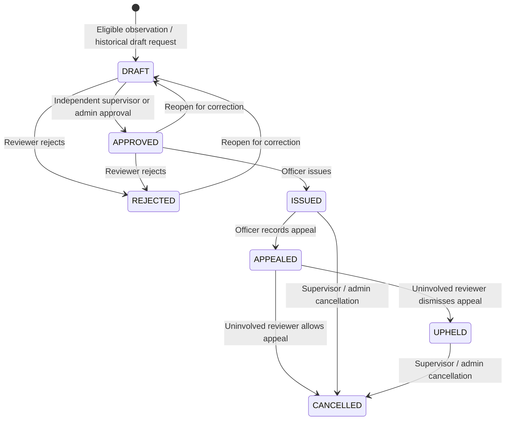

# 9.15 Digital Challan

The case register replaces count-derived issuance with a persisted, reviewed workflow. A fourth or later confirmed observation creates a **DRAFT**, not an issued penalty. Cases use stable `vehicles.id`, and a unique triggering `sighting_id` prevents duplicate cases for the same observation.

## Workflow and roles



- Administrator, Transport Officer and Supervisory Officer can create/open a draft and issue an approved case. Auditor has read-only access, including archived PDFs.
- Administrator or Supervisory Officer approves/rejects/reopens. The officer who prepared or amended a case cannot approve that case.
- Administrator or Transport Officer can amend the draft fine with a reason. Approval freezes the case snapshot.
- An officer records an appeal and its grounds/appellant details in notes. An uninvolved Administrator or Supervisory Officer resolves it; the approver, issuer and appeal-recording officer cannot decide that appeal.
- Issued or upheld cases may be sent through the existing notification integration. Pending appeals and cancellations block sending.
- Rejection, cancellation and appeal decisions preserve prior actions and the original issued document. There is no delete-case route.

The existing prototype threshold/fine formula remains: three warnings, then PKR 2,500 for the fourth confirmed observation, plus PKR 1,000 per additional observation. Each case charges its triggering observation; earlier observations support escalation. Historical observations are counted only through that trigger's event time, using stable vehicle identity. This is an application policy, not an assertion of an institutionally approved fine schedule.

New accepted live/manual-ANPR observations create eligible drafts in the same transaction as the sighting. Duty reviews that confirm a violation do the same. Existing historical data is not automatically converted into penalties: an officer can explicitly create/open the latest eligible draft for a vehicle. Repeated requests return the existing case, even if rejected/cancelled; they do not create duplicate charges.

## Review, evidence and immutable documents

The review screen shows current case inputs. Approval sends both `expected_version` and `review_fingerprint`. If registry details, supporting compliance or evidence metadata changed since the screen loaded, approval returns 409 and requires a new review.

Approval and issuance both require at least four confirmed, dated observations, verified evidence for the triggering observation, and matching SHA-256 hashes for all included archive files. An approved case whose inputs change must be returned to draft and approved again. Evidence must be reviewed through the existing Evidence screen.

Issuance sets fixed issuer/issue/due dates, renders the PDF once with supporting history, evidence hashes and an archived evidence image, stores its bytes and SHA-256 digest in PostgreSQL, and attaches evidence references. Subsequent downloads return those exact bytes, including after a plate correction or cancellation. The case register shows the current status; the archived document explicitly advises checking that status.

There are no fabricated bank accounts or banking PSIDs in the issued document or generated challan notices. Payment collection and bank settlement are not integrated. Old singular plate PDF/detail routes now require a persisted issued/upheld case and do not mutate evidence on GET.

## Persistence and code locations

Migration: `migrations/versions/0004_challans.py`, following `0003_duty_verification`.

| Component | Location / purpose |
|---|---|
| `Challan`, `ChallanEvent` | `backend/db_models.py`: stable reference, vehicle/trigger FKs, status/version, fine, actors/dates, approval snapshot/fingerprint, original PDF/hash; append-only application action records |
| `_ensure_challan_draft` | `backend/challan_store.py`: eligibility, unique trigger and automatic draft creation |
| `_challan_history`, `_challan_snapshot` | Stable-ID chronological violation context and relational evidence aggregation |
| `_check_challan_evidence` | Verified charged-observation evidence, archive path containment and file integrity |
| `challan_action` | Role/actor checks, optimistic version checks, transitions, approval freeze, issuance and audited reasons |
| `_challan_log` | Case history plus shared `AuditEvent` records in the same transaction |
| `challan_document`, `issued_challan_data` | Archived bytes and authorized issued-case lookup, including corrected plates |
| `backend/challan_pdf.py` | Issued PDF renderer |
| `backend/challan_api.py` | Validated authenticated case APIs |
| `backend/storage.py`, `backend/duty_store.py` | Draft-creation hooks; stable-ID summaries distinguish eligibility from issuance |
| `backend/main.py` | Legacy-route compatibility and issued-case-only notification dispatch |
| `backend/digital_twin.py` | Challan action timeline stream and case references |
| `frontend/src/pages/ChallansPage.tsx` | Case directory, filters, evidence review, transitions, archived PDF, delivery and action history |
| `frontend/src/api/client.ts` | `ChallanCase`, `challanRequest` and authenticated requests |
| `tests/test_challan_workflow.py` | Lifecycle, integrity, identity, stale input, rollback, archive, authorization and mocked delivery tests |

## APIs

| Method and path | Behavior |
|---|---|
| `GET /api/challans?status=&vehicle_id=&limit=30&offset=0` | Paginated register, including rejected/cancelled archive; limit 1–100 |
| `POST /api/challans` | `{vehicle_id}` creates/opens a draft for the latest eligible observation |
| `GET /api/challans/{id}` | Snapshot, current review inputs/fingerprint, status/version, actors/dates, PDF hash and action history |
| `POST /api/challans/{id}/actions` | `action`, `expected_version`, `notes` (10–2000 characters); approval additionally uses `review_fingerprint`; amendment uses `fine_amount` (integer PKR 0–1,000,000) |
| `GET /api/challans/{id}/pdf` | Original archived issued PDF, including cancelled/appealed cases; returns 409 before issuance |
| `GET /api/challan/{plate}` | Compatibility lookup for latest issued/upheld case |
| `GET /api/challan/pdf/{plate}` | Compatibility read of the same archived document |
| `POST /api/send-notification` | For challans, requires `message_type=challan`, explicit `challan_id` reference and plate; amount/count/PDF come from the saved case, not client-supplied overrides |

Actions: `amend`, `approve`, `reject`, `reopen`, `issue`, `appeal`, `uphold`, `cancel`. Invalid transitions/stale versions return 409; role/self-approval violations return 403. All API routes require authentication.

Delivery events record `SENT`, `LINK_CREATED`, or `FAILED_OR_BLOCKED`. A generated WhatsApp URL is not marked sent. Pilot dispatch uses the transaction lock to serialize against appeals/cancellations. Provider acceptance is not recipient acknowledgment; network success followed by a database/process failure can still leave an uncertain delivery result. No durable outbox, automatic retry, or exactly-once external delivery is claimed.

## Docker and demonstration

```powershell
docker compose build backend frontend
docker compose run --rm --no-deps backend python -m backend.test_runner --postgres
docker compose run --rm --no-deps frontend npm run build
docker compose up -d db backend frontend
docker compose exec -T backend python -m alembic current
```

Startup applies the additive migration. The PostgreSQL named volume is retained. Tests use a disposable schema and temporary images; notification providers are mocked.

Open **Challans**, or **Open Cases** from Violations. Select a vehicle, create/open a historical draft if necessary, review its evidence, and use another authorized reviewer to approve. Issue after approval to obtain the archived PDF. Record an appeal and resolve it using an uninvolved supervisory account. Case actions also appear in the vehicle's Digital Twin.

For the existing demo accounts, a practical separation is: Transport prepares, Admin approves/issues, Transport records an appeal, Supervisor decides it. Do not send notifications to real recipients during a demonstration unless intended.

On this computer, the app opens at `http://localhost:15173` (`FRONTEND_PORT`) and host PostgreSQL uses `127.0.0.1:15432` (`POSTGRES_PORT`) through ignored local `.env` overrides, because Windows reserved ports 5173 and 5433. Project defaults remain 5173 and 5433; container connections remain frontend port 5173 and `db:5432`.

Validation: **118 backend tests passed against isolated PostgreSQL**, including 15 new challan tests; the frontend TypeScript/Vite production build passed. Migration `0004_challans` is deployed, `alembic check` reports no pending schema operations, and live read-only case/API/proxy/Digital Twin/statistics checks passed. Existing live records were preserved and the new case tables remain empty. No browser-driven interaction test or real external send was performed.

## Remaining limits

Estimated scope coverage: **90%**. Automatic drafts, designated review, issuance and history/archive receive full implementation credit; appeals retain partial credit because they are recorded by officers rather than a separate appellant submission/evidence-upload workflow. Institutional approval of fines/processes, department-scoped access, payment integration, delivery acknowledgment and resilient external dispatch remain outstanding. No live cases are automatically issued or external messages sent during migration.
